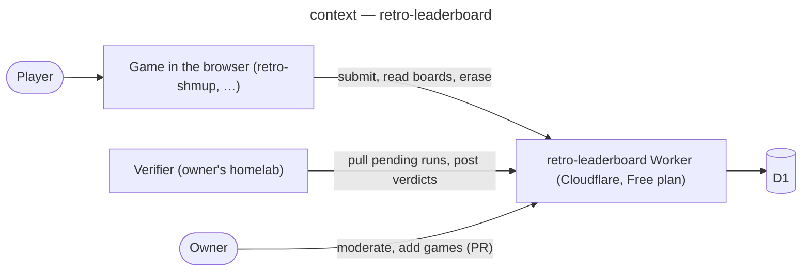

# Architecture — retro-leaderboard

The conception study of the shared online leaderboard: scope, method and a map of the documents that define it before any implementation code.

## Method and scope

- **Method**: a light ICONIX-style path (use cases → sequence → component → data model → state),
  with every structural choice in an ADR. No code before these documents are merged.
- **Scope**: one HTTP API on Cloudflare Workers shared by the owner's retro browser games, and a
  verifier on the owner's homelab that replays runs. In scope: submitting runs, verifying them,
  public boards, erasure, moderation, game registration. Out of scope for this study: notifications
  of new records (Telegram idea), accounts, cross-game rankings.
- **Stakeholders**: players (publish and compare scores), the owner (runs and moderates the service).
- **Goals**: scores nobody can forge from the browser; no recurring cost; the minimum of personal
  data; one service for every game.

## Context (C4 level 1)

## How to read this folder

| Document | Content |
|---|---|
| [glossary.md](glossary.md) | Every domain term, defined once |
| [traceability-matrix.md](traceability-matrix.md) | Use cases and requirements ↔ diagrams ↔ ADRs ↔ future tests |
| [decisions/](decisions/) | ADR-0001 verification on the homelab · ADR-0002 D1 · ADR-0003 abuse limits · ADR-0004 personal data · ADR-0005 game ids |
| [diagrams/leaderboard/](diagrams/leaderboard/) | 01 use cases · 02 submit and verify sequence · 03 components · 04 data model · 05 run lifecycle |

## Client side

Each game records its runs and submits them; for retro-shmup that work (run recording format,
"Send online" flow, GDD revision and ADR) is tracked in the retro-shmup repository under epic
benoit-bremaud/retro-shmup#166.
