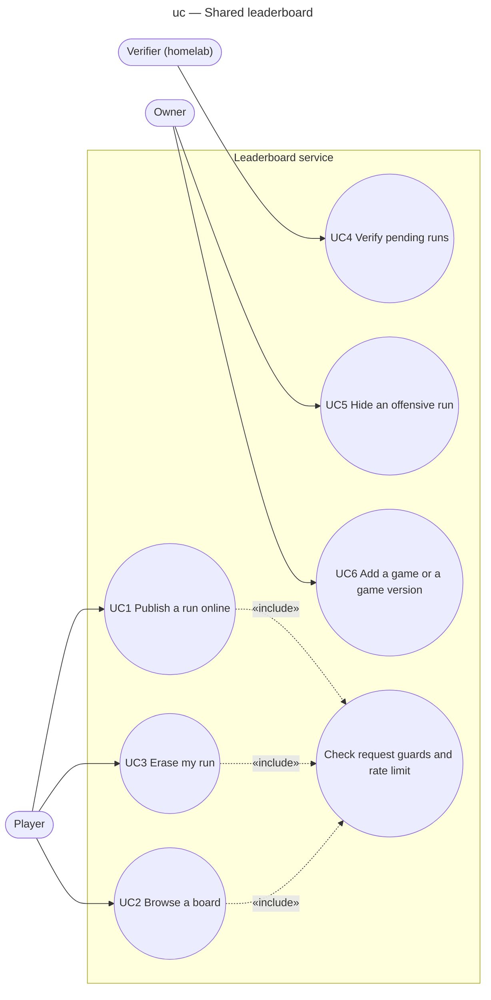

# Use case diagram — leaderboard — who wants what from the shared board

> **Feature**: epic benoit-bremaud/retro-shmup#166 — shared online leaderboard API for retro games
> **Related ADRs**: ADR-0001, ADR-0003, ADR-0004, ADR-0005
> **Realises**: UC1–UC6 · **See also**: `02-sequence-submit-verify.md`, `05-state-run.md`

## Context

The subject is the leaderboard service (Worker + verifier). The player acts through a game, so the
game client is not an actor of its own: it is the player's tool. The owner administers. The
verifier is a secondary actor, the system part that runs on the homelab; it initiates its own goal
(UC4), triggered by its timer.

## Diagram

## Use cases (brief form)

| ID | Goal | Primary actor | Main success scenario | Extensions |
|---|---|---|---|---|
| UC1 | Publish a finished run on the online board | Player | The player chooses "Send online" after a run; the game sends the run; the service stores it as `pending` and returns the run id and a deletion token; the game shows "pending verification" | Guard or rate limit fails → refused with a code; unknown game version → refused |
| UC2 | See the best verified scores of a game and mode, all-time or this month | Player | The game (or a page) asks for the board; the service returns the top 100 verified, not hidden runs | Empty board |
| UC3 | Remove my run and my name from the board | Player | The game sends the run id and the deletion token kept at UC1; the service erases the row | Wrong token → `404` (same answer as an unknown id); lost token → contact the owner |
| UC4 | Turn pending runs into verdicts | Verifier | Every minute the verifier pulls pending runs, replays each at its game version, posts `verified`, `rejected` or `unverifiable` | Service unreachable → retry next tick; replay over 10 s CPU → `rejected` |
| UC5 | Take an offensive or abusive run off the board | Owner | The owner hides the run by id through the admin route | Run unknown → `404` |
| UC6 | Let a new game or a new version submit runs | Owner | The owner adds it to the allowlist (`src/games.ts`) and publishes its simulation package to the verifier, through a gated PR | — |

## Notes

- Purge (ADR-0004) and the daily salt rotation (ADR-0003) are scheduled system behaviour, not
  actor goals: they appear in the state diagram, not here.
- UC1 says nothing about the score being genuine: UC4 decides that, after the fact.
