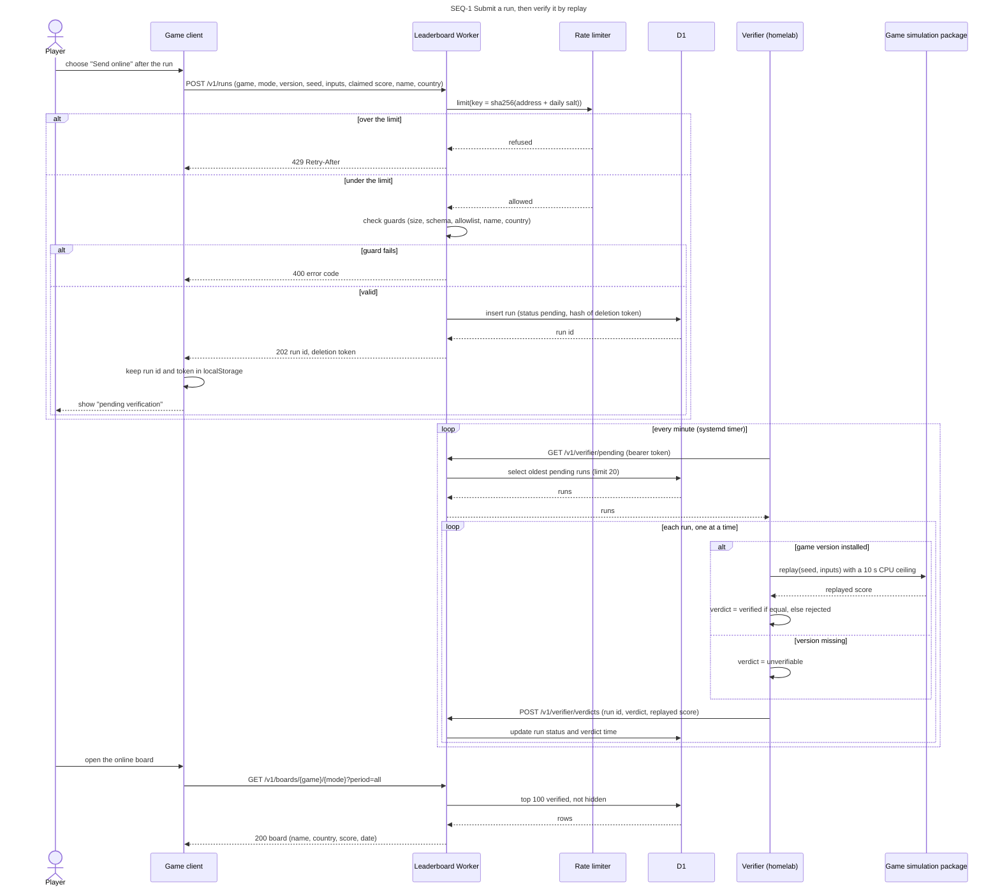

# Sequence diagram — leaderboard — submit a run, then verify it by replay

> **Feature**: epic benoit-bremaud/retro-shmup#166
> **Related ADRs**: ADR-0001, ADR-0002, ADR-0003, ADR-0004, ADR-0005
> **Realises**: UC1, UC4 · **See also**: `05-state-run.md`, `04-class-data-model.md`

## Context

The submission and its verification are two separate exchanges: the game never waits for the
replay. The verifier only makes outbound calls, so the homelab exposes no port.

## Diagram

## Notes

- `202 Accepted`, not `201`: the run exists but is not on the board yet.
- The verifier posts a verdict per run, so a crash mid-batch loses at most one replay; a run with
  no verdict stays `pending` and comes back next tick.
- A verdict for a run that is no longer `pending` (deleted, expired) is ignored with `409`.
