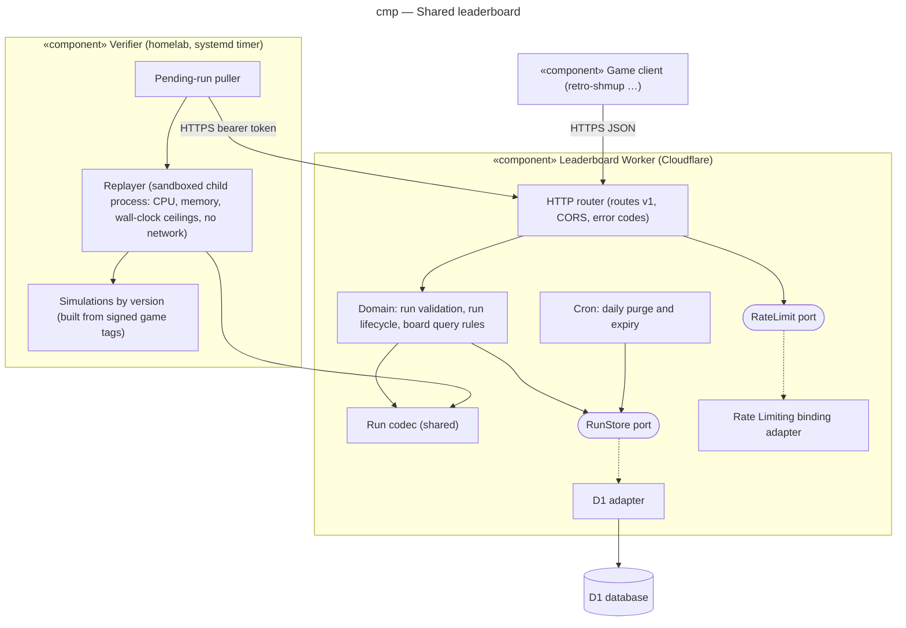

# Component diagram — leaderboard — Worker, verifier and their ports

> **Feature**: epic benoit-bremaud/retro-shmup#166
> **Related ADRs**: ADR-0001, ADR-0002, ADR-0003
> **Realises**: UC1–UC6 · **See also**: `02-sequence-submit-verify.md`

## Context

Two deployables: the Worker on Cloudflare (Free plan) and the verifier on the homelab. Inside the
Worker, the domain (run rules, validation, verdict rules) depends only on ports; the adapters
bind D1, the rate limiter and the secrets (verifier token, `RATE_KEY_SECRET`). The verifier reuses the same run codec (shared module
in this repository) and runs each game's simulation built from its signed release tag.

## Diagram

## Notes

- Dependency rule: `domain` imports neither D1 nor the Workers runtime; adapters implement the
  ports. Tests replace the ports, never the domain.
- The run codec is the only code shared by the Worker and the verifier: one source of truth for the
  run format (defined by the client-side brick of each game).
- The verifier never writes to D1 directly: every report goes through the Worker, which sets the
  verdict.
- Moderation has no component: the owner edits D1 with `wrangler d1 execute` (ADR-0003).
