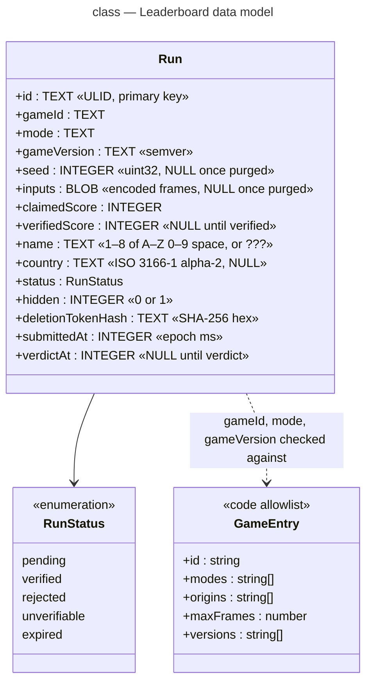

# Class diagram — leaderboard — data model

> **Feature**: epic benoit-bremaud/retro-shmup#166
> **Related ADRs**: ADR-0002, ADR-0004, ADR-0005
> **Realises**: UC1–UC5 · **See also**: `05-state-run.md`

## Context

One table holds every run; the boards are queries on it, not tables. The game allowlist lives in
code (ADR-0005), not in the database. Types are the D1 (SQLite) storage types.

## Diagram

## Indexes

- `runs_board` on `(game_id, mode, status, hidden, verified_score DESC, verdict_at)` — board reads
  (UC2): `WHERE status = 'verified' AND hidden = 0 ORDER BY verified_score DESC, verdict_at ASC
  LIMIT 100`. Ties go to the earlier verdict.
- `runs_pending` on `(status, submitted_at)` — verifier pulls (UC4) and the expiry job.

## Notes

- `id` is a ULID: unguessable enough for a public id, sortable by time, no counter to leak volume.
- The monthly board filters `submitted_at` on the current UTC month.
- Purge (ADR-0004) sets `seed` and `inputs` to NULL; a purged run keeps its board row.
