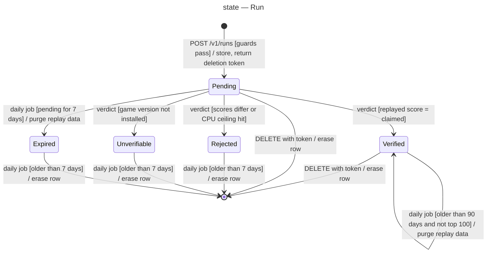

# State machine diagram — leaderboard — lifecycle of a run

> **Feature**: epic benoit-bremaud/retro-shmup#166
> **Related ADRs**: ADR-0001, ADR-0004
> **Realises**: UC1, UC3, UC4, UC5 · **See also**: `04-class-data-model.md`

## Context

`RunStatus` drives what is public and what is purged. `hidden` is an orthogonal flag set by the
owner (UC5); it only matters on a verified run.

## Diagram

## Notes

- Only `Verified` and not hidden is public (UC2).
- `Unverifiable` exists so the owner sees a missing simulation version in the logs; publishing the
  version later does not revive the run (the player plays again).
- Every transition not shown is refused: a verdict on a non-pending run answers `409`.
