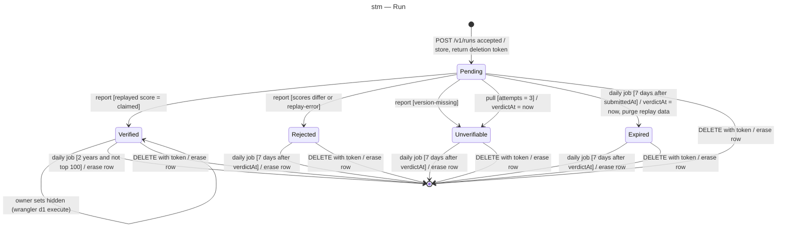

# State machine diagram — leaderboard — lifecycle of a run

> **Feature**: epic benoit-bremaud/retro-shmup#166
> **Related ADRs**: ADR-0001, ADR-0003, ADR-0004
> **Realises**: UC1, UC3, UC4, UC5 · **See also**: `04-class-data-model.md`

## Context

`RunStatus` drives what is public and what is purged. `hidden` is an orthogonal flag set by the
owner (UC5); it only matters on a verified run. The creation guards (ADR-0003) run before the row
exists, so a refused request never enters this machine.

## Diagram

## Notes

- Only `Verified` and not hidden is public (UC2).
- `Unverifiable` exists so the owner sees a missing simulation version or a poison run in the logs;
  publishing the version later does not revive the run (the player plays again).
- Every transition not shown is refused: a report on an unknown or deleted run answers `404`, on a
  non-pending run `409`.
- The replay-data purge is a self-transition: the run stays verified and on its board, but can no
  longer be re-verified.
